# Retail Sales Forecasting & Inventory Optimization System

> Forecast daily demand for 60 store-product combinations, then turn the forecast into **reorder points, safety stock, and purchase-order recommendations**. In a simulation on the last 8 weeks of demand, the system **cut stockout days from 6.7% to 2.2% and lowered total inventory cost by about 40%** compared with the store's rule-of-thumb policy.


---

## Table of contents
- [Project overview](#project-overview)
- [Problem statement](#problem-statement)
- [Industry relevance & business value](#industry-relevance--business-value)
- [Results](#results)
- [Tech stack](#tech-stack)
- [Architecture](#architecture)
- [Folder structure](#folder-structure)
- [Dataset (virtual simulation)](#dataset-virtual-simulation)
- [Installation](#installation)
- [How to run](#how-to-run)
- [Simulation workflow](#simulation-workflow)
- [Screenshots](#screenshots)
- [Future improvements](#future-improvements)
- [Learning outcomes](#learning-outcomes)
- [Author](#author)

---

## Project overview
This is an end-to-end retail analytics system for a simulated supermarket chain with **3 stores, 20 products, 5 categories, and 2 years of daily sales**. Running one command does all of the following:

1. **Simulates** realistic retail data: trend, weekly and yearly seasonality, Indian festivals, promotions, supplier delays, stockouts, and messy POS data.
2. **Cleans** the data: duplicates, missing values, negative quantities, outliers, and inconsistent text.
3. **Explores** sales patterns with 8 business charts.
4. **Engineers** 17 time-series features while avoiding data leakage.
5. **Forecasts** demand with a Seasonal Naive baseline, Linear Regression, and Random Forest, evaluated honestly with a 56-day recursive backtest.
6. **Optimizes inventory** with Safety Stock, Reorder Point, EOQ, and days-of-cover rules, then generates reorder alerts.
7. **Simulates** the old and new stock policies on real demand to measure the business impact.
8. **Reports** results through 16 charts, a business insights report, and an interactive Streamlit dashboard.

## Problem statement
Retailers lose money in two opposite ways:
- **Stockouts**: the shelf is empty, the customer walks away, and the sale is lost (often to a competitor).
- **Overstock**: cash is locked in unsold goods, which also cost money to store and may expire.

The simulated chain re-orders with a fixed rule of thumb: *"when stock looks low, order 3 weeks of average sales."* The rule ignores growth, seasonality, and festivals. As a result, products were out of stock on **7.9%** of store-product-days, and **Rs. 1.5 crore** of revenue was lost over 2 years.

**Goal:** forecast demand accurately, then decide **when** to order and **how much** for every product in every store.

## Industry relevance & business value
| Company type | How they use this |
|---|---|
| Supermarkets (D-Mart, Reliance Retail, Walmart) | Store-SKU demand forecasts drive automatic replenishment from distribution centres |
| E-commerce (Amazon, Flipkart) | Forecasts decide which warehouse stocks what, and how much to buy before sale events like Big Billion Days |
| Quick commerce (Blinkit, Zepto) | Forecasts at the dark-store level help avoid "out of stock" on a 10-minute delivery promise |
| FMCG brands | Forecasts feed production and distribution planning |

**Business value demonstrated:** fewer lost sales, a higher fill rate, lower total inventory cost, and a daily action list that a store manager can use directly.

## Results
All numbers below are produced by `python main.py` (seed 42).

**Forecast accuracy (56-day recursive test, Nov–Dec 2024)**

| Model | MAE (units) | Daily WAPE | Weekly WAPE | Bias |
|---|---|---|---|---|
| Seasonal Naive (baseline) | 13.30 | 54.2% | 35.0% | +31.2% |
| Linear Regression | 9.79 | 39.9% | 21.3% | +7.6% |
| **Random Forest (selected)** | **9.35** | **38.1%** | **20.4%** | **+6.8%** |

The Random Forest has **30% lower error than the baseline**. At the weekly level, which is how replenishment is planned, its error is about **20%**.

**Inventory policy simulation (same real demand, same starting stock)**

| KPI | Old naive rule | Forecast-driven policy |
|---|---|---|
| Fill rate | 97.8% | **99.2%** |
| Stockout days | 6.7% | **2.2%** |
| Lost revenue | Rs. 9.23 lakh | **Rs. 2.66 lakh** |
| Purchase orders | 203 | **162** |
| Total cost (holding + ordering + lost margin) | Rs. 3.68 lakh | **Rs. 2.22 lakh (−40%)** |

There is a trade-off: average inventory is 31% higher, but it is held where demand actually needs it. See [`reports/business_insights.md`](reports/business_insights.md) for the full report.

## Tech stack
| Layer | Tools |
|---|---|
| Language | Python 3.11+ |
| Data | Pandas, NumPy |
| Visualization | Matplotlib, Seaborn |
| Machine learning | scikit-learn (Linear Regression, Random Forest) |
| Inventory math | Safety Stock, Reorder Point, EOQ (NumPy + `statistics.NormalDist`) |
| Dashboard | Streamlit |
| Testing | pytest (14 unit tests) |
| Notebook | Jupyter |

## Architecture
```
 ┌────────────────────┐   ┌──────────────────────┐   ┌─────────────────┐
 │ 1. Virtual retail  │──▶│ 2. Data cleaning     │──▶│ 3. EDA          │
 │    simulation      │   │  dupes, NaN, outliers│   │  8 charts       │
 │ data/raw/*.csv     │   │ data/processed/      │   │ images/01-08    │
 └────────────────────┘   └──────────┬───────────┘   └─────────────────┘
                                     ▼
 ┌────────────────────┐   ┌──────────────────────┐
 │ 5. Forecasting     │◀──│ 4. Feature           │
 │ Naive / LR / RF    │   │    engineering       │
 │ recursive backtest │   │  17 leak-free feats  │
 │ 30-day forecast    │   └──────────────────────┘
 └─────────┬──────────┘
           ▼
 ┌────────────────────┐   ┌──────────────────────┐   ┌─────────────────┐
 │ 6. Inventory       │──▶│ 7. Policy simulation │──▶│ 8. Reporting    │
 │ SS, ROP, EOQ,      │   │ old rule vs new      │   │ charts, report, │
 │ status + alerts    │   │ policy on real demand│   │ Streamlit app   │
 └────────────────────┘   └──────────────────────┘   └─────────────────┘
```

## Folder structure
```
Retail-Sales-Forecasting-Inventory-Optimization/
├── app/
│   └── streamlit_app.py          # interactive dashboard
├── data/
│   ├── raw/                      # simulated POS export + master data
│   └── processed/                # cleaned + feature tables (git-ignored, regenerated)
├── docs/
│   ├── PROJECT_GUIDE.md          # full beginner guide: concepts, phases, simulation, troubleshooting
│   ├── GITHUB_AND_PROOF_PLAN.md  # git commands, commit plan, screenshot checklist
│   ├── INTERVIEW_PREP.md         # resume bullets, LinkedIn posts, interview Q&A
│   ├── SOCIAL_POSTS.md           # ready-to-post LinkedIn & Instagram captions
│   └── sample_terminal_output.txt
├── images/                       # 16 charts, screenshots/ (proof), social/ (carousel)
├── models/                       # trained model (.joblib, git-ignored) + metadata.json
├── notebooks/
│   └── project_walkthrough.ipynb # step-by-step notebook view of the results
├── outputs/                      # CSV results: forecast, recommendations, alerts, metrics
├── reports/
│   └── business_insights.md      # auto-generated business report
├── src/
│   ├── config.py                 # all settings in one place
│   ├── data_generator.py         # virtual retail simulation
│   ├── data_preprocessing.py     # cleaning + data-quality report
│   ├── eda.py                    # exploratory charts
│   ├── feature_engineering.py    # calendar, lag, baseline features
│   ├── forecasting.py            # models, recursive backtest, 30-day forecast
│   ├── inventory_optimization.py # SS / ROP / EOQ + policy simulation
│   └── visualization.py          # result charts + business report
├── scripts/
│   └── make_social_posts.py      # builds Instagram/LinkedIn carousel from results
├── tests/                        # pytest unit tests
├── main.py                       # runs the whole pipeline
├── requirements.txt
├── pytest.ini
└── .gitignore
```

## Dataset (virtual simulation)
No real company data is used. `src/data_generator.py` builds the dataset from explicit business rules:

| Component | How it is simulated |
|---|---|
| Stores | 3 stores (Mumbai, Bengaluru, Delhi) with different size factors |
| Products | 20 SKUs across Groceries, Dairy & Bakery, Personal Care, Home Care, Electronics |
| Trend | Category growth from +6% to +25% per year |
| Weekly pattern | Friday ×1.10, Saturday ×1.30, Sunday ×1.25 |
| Yearly seasonality | Summer products (sunscreen, fans, curd) and winter products (kettle) |
| Festivals | Diwali, Holi, Republic Day, Independence Day, New Year (Diwali boosts Electronics ×2.1) |
| Salary week | Days 1–5 of the month ×1.10 |
| Promotions | About 6 three-day promotions per product per year, with a 10% discount and a 30–60% uplift |
| Noise | Gamma-Poisson (over-dispersed, like real retail data) |
| Stock movements | Day-by-day simulation of the old rule, with lead times of 2–10 days and random supplier delays |
| Data quality issues | 1% missing sales, 0.5% missing prices, duplicates, negative quantities, typo outliers, messy text |

**Raw file columns:** `date, store_id, product_id, category, unit_price, promotion, festival_period, units_sold, opening_stock, units_received, closing_stock, stockout_flag, lost_sales_units` (43,992 rows).

## Installation
```bash
git clone https://github.com/SNischayPrasad/Retail-Sales-Forecasting-Inventory-Optimization.git
cd Retail-Sales-Forecasting-Inventory-Optimization
python -m venv .venv
# Windows:   .venv\Scripts\activate
# Mac/Linux: source .venv/bin/activate
pip install -r requirements.txt
```

## How to run
```bash
python main.py                         # full pipeline (~45 s on a laptop, no GPU)
pytest -v                              # run the 14 unit tests
streamlit run app/streamlit_app.py     # open the dashboard at http://localhost:8501
jupyter notebook notebooks/project_walkthrough.ipynb   # optional notebook walkthrough
```
Each module can also be run on its own, for example `python -m src.data_generator` or `python -m src.forecasting`.

**Key output files**

| File | What it contains |
|---|---|
| `outputs/forecast_next_30_days.csv` | Daily forecast per store-product for the next 30 days |
| `outputs/inventory_recommendations.csv` | Safety stock, ROP, EOQ, status, and order quantity for all 60 items |
| `outputs/reorder_alerts.csv` | Only the items that must be ordered today |
| `outputs/model_metrics.csv` | Model comparison |
| `outputs/policy_comparison.csv` | Results of the old vs new policy simulation |
| `reports/business_insights.md` | Plain-English report for managers |

## Simulation workflow
1. Generate 2 years of demand from business rules.
2. Run the old stock rule day by day to produce sales, stockouts, and lost sales.
3. Add realistic data errors, then clean them.
4. Train models on Jan 2023 – 5 Nov 2024 and test them on the remaining 56 days. The models never see actual test sales and feed their own forecasts back in as inputs.
5. Retrain the best model on all data and forecast the next 30 days (Jan 2025).
6. Convert the forecast into safety stock, reorder point, and EOQ, and flag CRITICAL / REORDER / OVERSTOCK / HEALTHY items.
7. Replay the 56 test days under both stock policies and compare cost and service level.

## Screenshots
| | |
|---|---|
| 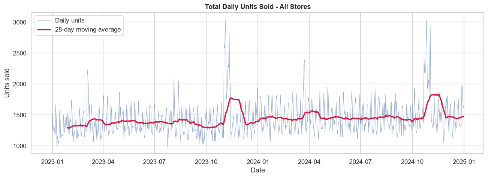 | 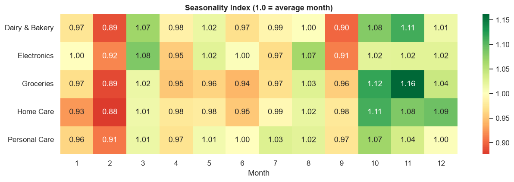 |
| 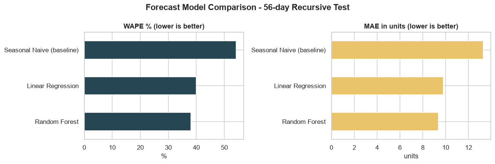 | 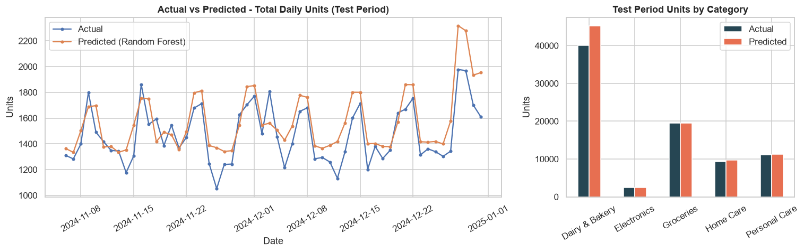 |
| 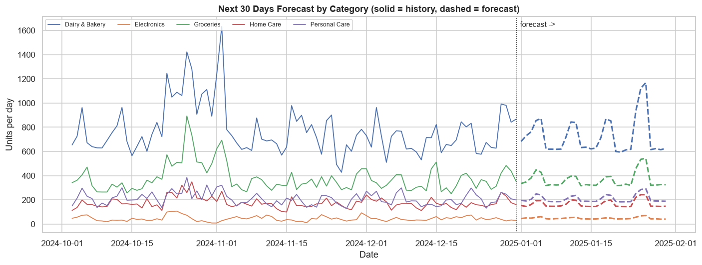 | 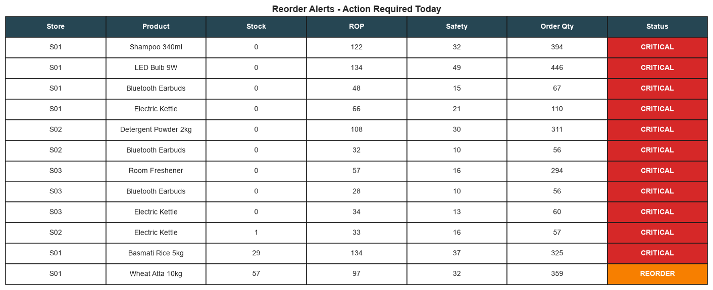 |
| 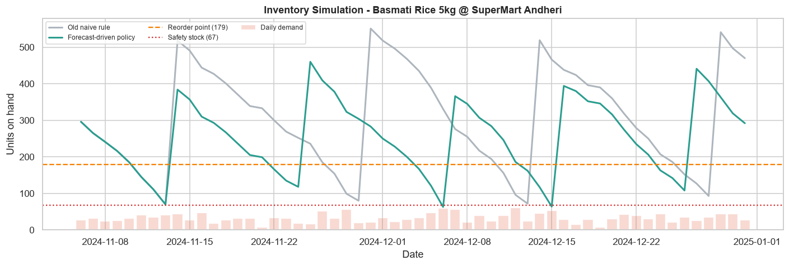 | 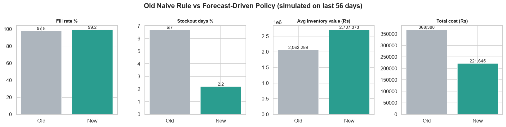 |

**Streamlit dashboard**

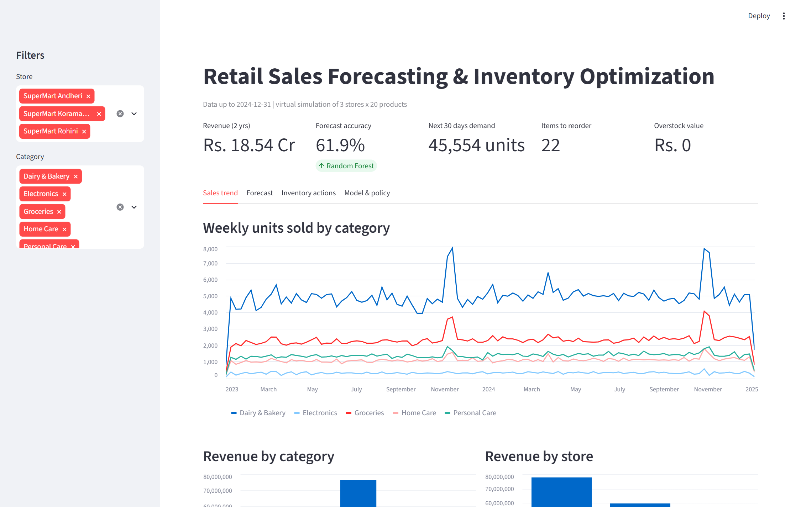
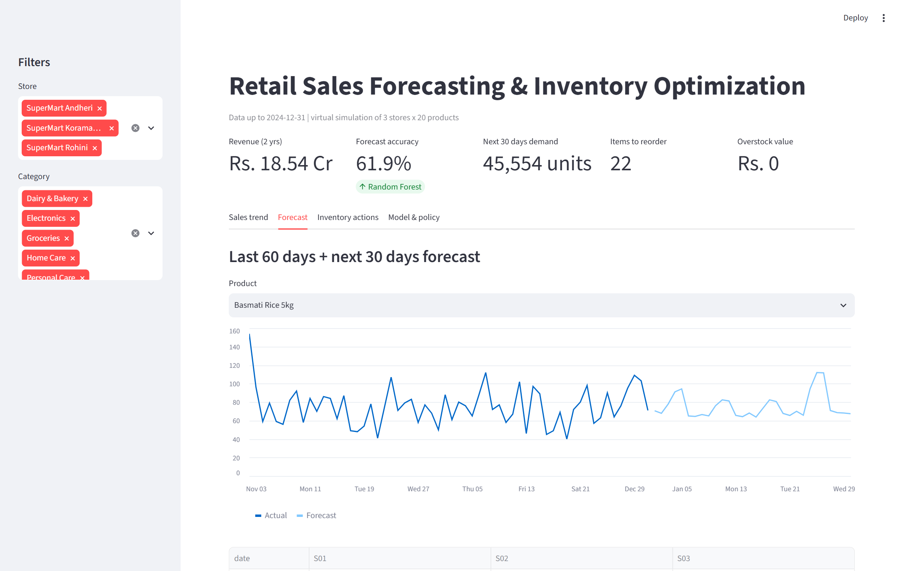
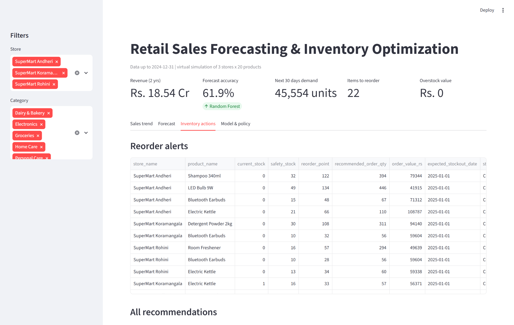

## Future improvements
- Use LightGBM/XGBoost with hyperparameter tuning and quantile forecasts that output prediction intervals.
- Correct for censored demand: estimate true demand on days with stockouts.
- Add a promotion and price-elasticity model to answer "what if we give 15% off?"
- Add weather and event signals, and region-level demand models.
- Add multi-echelon optimization (warehouse → store) and supplier MOQ constraints.
- Schedule daily runs (Airflow or GitHub Actions) and deploy the dashboard on Streamlit Cloud.
- Add anomaly detection for unusual sales spikes or drops.

## Learning outcomes
- Built an honest time-series validation: time-based split, recursive multi-step forecasting, and leakage-free features.
- Applied the supply-chain formulas used in industry: safety stock, reorder point, and EOQ.
- Translated model metrics (WAPE, bias) into business KPIs (fill rate, lost revenue, total cost).
- Wrote modular, tested, and reproducible Python code with a dashboard on top.

## Author
**Your Name**: aspiring Data / Business / Supply Chain Analyst
[LinkedIn](https://linkedin.com/in/your-profile) · [GitHub](https://github.com/SNischayPrasad) · your.email@example.com

*Data is fully synthetic and was created for learning and portfolio purposes.*
